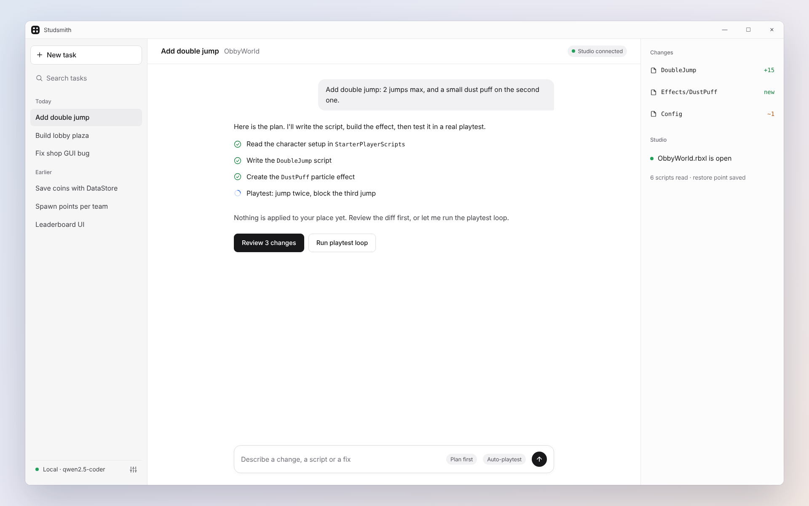
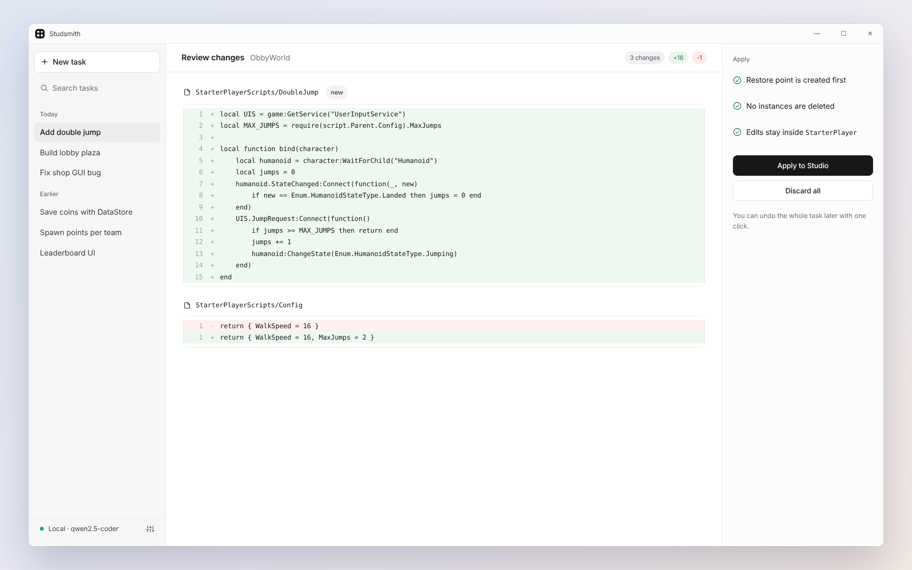
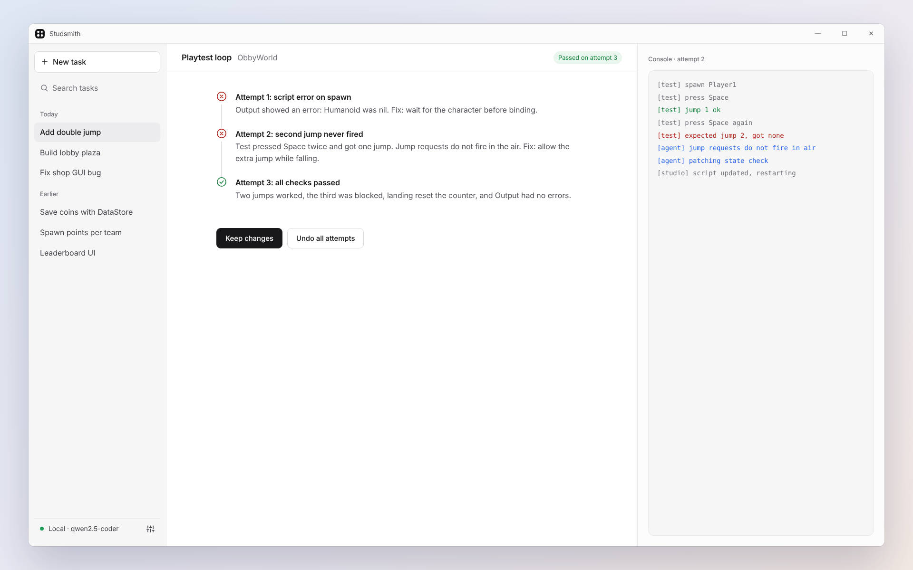
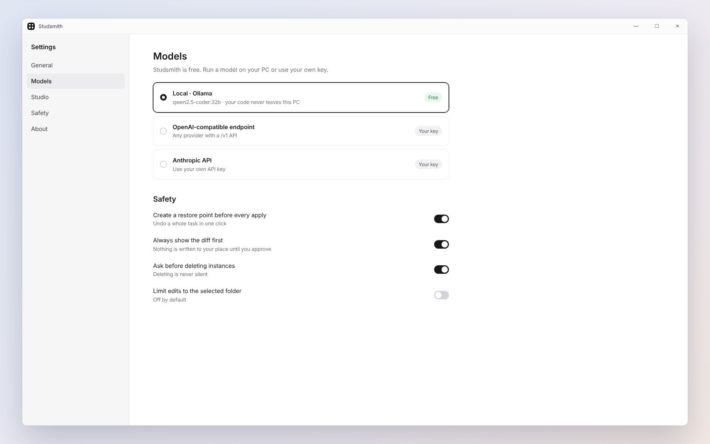

<a href="README.md">English</a> · <b>简体中文</b>

  
  
  

# Studsmith

### Roblox Studio 的 AI 智能体。

Studsmith 是一款免费的 Windows 应用，帮你更快地制作 Roblox 游戏。用日常语言描述你想要的效果，智能体就会编写 Luau 脚本，在你的游戏里完成设置，并说明改了什么。

<a href="../../releases/latest"><b>下载 Windows 版</b></a>

<table>
<tr>
<td width="50%"> 应用前<b>审查改动</b>。</td>
<td width="50%"> <b>试玩循环：</b>尝试、报错和修复集中在一条时间线上。</td>
</tr>
<tr>
<td colspan="2"> <b>设置：</b>模型、Studio 连接和安全选项。</td>
</tr>
</table>

## 你可以做什么

- 用日常语言描述功能，先得到清晰的计划，再得到可运行的 Luau 代码
- 根据文字描述在游戏中创建和整理对象
- 每处改动在应用到场景之前都以差异形式展示，供你审查
- 通过还原点撤销单项改动或整个任务
- 试玩循环会运行你的游戏、读取报错并自动修复
- 使用本地模型或你自己的 API 密钥
- 查找并修复脚本中的 bug，并附通俗易懂的说明

## 安装

1. 打开[最新版本](../../releases/latest)，下载 `Studsmith-win-x64.zip`。
2. 解压到任意位置。
3. 运行 `Studsmith.exe`。

需要 Windows 10 或 11（64 位）。由于应用较新且未做代码签名，Windows 可能弹出 SmartScreen 警告：点击**更多信息**，再点**仍要运行**。每个版本的 SHA-256 校验值都写在发布说明里，方便你核对下载文件。

## 支持与反馈

发现 bug 或有想法？[提交 issue](../../issues/new/choose)。告诉我们 Roblox 开发中最耗时间的任务，我们会优先解决。

## 免责声明

Studsmith 是独立项目，与 Roblox Corporation 没有关联，也未获其认可或赞助。“Roblox”和“Roblox Studio”是 Roblox Corporation 的商标。

关键词：Roblox AI 助手、Roblox Studio AI、Roblox 脚本 AI、Luau 代码生成、Roblox 游戏开发智能体。
